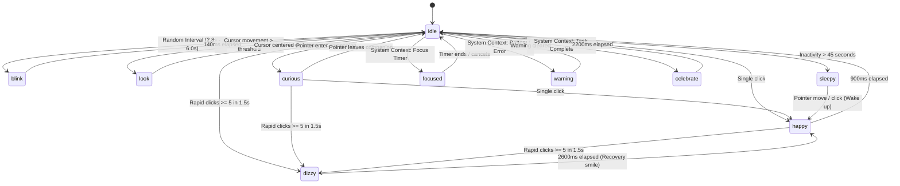

# PROJECT_NOTCH — Companion Mascot Specification: "Pip"

**Status:** Phase 2 Complete  
**Reference Document:** [PRODUCT_SPEC.md](../PRODUCT_SPEC.md) Section 12  
**Implementation:** [src/mascot/renderer.ts](../src/mascot/renderer.ts), [src/mascot/state-machine.ts](../src/mascot/state-machine.ts), [src/mascot/MascotCanvas.svelte](../src/mascot/MascotCanvas.svelte)

---

## 1. Character Identity & Visual Form

`Pip` is an original Windows desktop companion designed as a precision-crafted robotic familiar / cyber-sentinel.

### Anti-Derivative Invariant
Pip is **not** a cat, bunny, mochi blob, or Dynamic Island bubble. Its design uses clean desktop-native mechanical curves, dark titanium finishes, an obsidian visor faceplate, and luminous vector aperture eyes.

```text
       ╭─╮         ╭─╮       <- Sensor Ears / Antennae (pivot with emotion)
     ╭─╯ ╰─────────╯ ╰─╮
    │  ╭─────────────╮  │    <- Dark Titanium Chassis (#141619)
    │  │  ╭─╮   ╭─╮  │  │    <- Obsidian Visor Faceplate (#090a0d)
    │  │  ╰─╯   ╰─╯  │  │    <- Luminous Aperture Eyes (#38bdf8)
    │  ╰─────────────╯  │
     ╰─────────────────╯     <- Ground Anchor for Squash & Stretch
```

### Visual Components
1. **Chassis:** Dark slate titanium (`#141619`) squircle (46px × 38px, radius 13px) with subtle 1px specular rim highlight (`rgba(255, 255, 255, 0.12)`).
2. **Visor Faceplate:** Inset obsidian glass (`#090a0d`, 38px × 26px, radius 9px) with delicate diagonal gloss reflection.
3. **Sensor Ears:** Twin top-mounted micro-antennae with color-coded status LEDs that pivot dynamically with emotional physics.
4. **Luminous Aperture Eyes:** Twin responsive apertures rendered with high-contrast electric azure glow (`#38bdf8`) and state-dependent color accents.

---

## 2. Mascot State Model

Pip implements all 10 discrete states defined in `PRODUCT_SPEC.md`:

| State | Visual Expression | Ear Posture | Primary Trigger | Default Duration |
| :--- | :--- | :--- | :--- | :--- |
| `idle` | Resting rounded pills (6×8px), subtle glow | Neutral (-18° / +18°) | Default resting state | Persistent |
| `blink` | Eyelids squeeze flat (height 1.2px) | Neutral | Randomized timer | 140ms |
| `look` | Apertures follow cursor within socket bounds | Neutral | Mouse moved across notch | Interactive |
| `curious` | Left eye widens, head tilts +5° | Asymmetric (+10° / -5°) | Hovering companion zone | Interactive |
| `happy` | Cheerful upward arcs (`◠ ◠`) | Perked up (+32°) | Single click or recovery | 900ms |
| `focused` | Determined horizontal visor slits (8×3.2px) | Forward alignment | Focus timer active | Context-driven |
| `sleepy` | Heavy half-lidded eyes, floating 'z' particles | Drooped down (-7°) | 45s of user inactivity | Until wake event |
| `celebrate` | Golden 4-point sparkle star eyes, body hop | Flutter / perk | Download / task complete | 2200ms |
| `warning` | Amber alert slits, subtle alert vibration | Erect alert | Low battery / system warning | Context-driven |
| `dizzy` | Twin spinning spirals, wobbling head, 2 orbit stars | Alternating wobble | Rapid clicks (≥5 in 1.5s) | 2600ms |

---

## 3. State Transition Matrix & Architecture



---

## 4. Physical Dynamics & Behaviors

### 4.1 Clamped Cursor Gaze & Interpolation
- Gaze coordinates are normalized from pointer offset relative to canvas center.
- Clamped strictly within orbital sockets:
  $$\Delta X \in [-4.0\text{px}, +4.0\text{px}], \quad \Delta Y \in [-3.0\text{px}, +3.0\text{px}]$$
- Smooth exponential ease-out interpolation (lerp factor `0.16`) eliminates jarring steps:
  $$\text{gaze}_{t+1} = \text{gaze}_t + (\text{target} - \text{gaze}_t) \times 0.16$$

### 4.2 Tactile Squash & Harmonic Spring Recoil
- Click applies an immediate vertical compression impulse:
  $$\text{scaleY} = 0.82, \quad \text{scaleX} = 1.14$$
- The chassis recovers using a damped harmonic oscillator:
  $$F = -k \cdot (\text{scaleY} - 1.0) \cdot 100 - c \cdot v_y$$
  where $k = 0.022$, $c = 0.82$.
- The base anchor point is anchored to the notch shelf ($Y = \text{center} + 18\text{px}$), ensuring Pip compresses down against the shelf and rebounds upward naturally.

### 4.3 Rapid-Click Dizzy Reaction & Cooldown
- Clicks within a sliding $1500\text{ms}$ window are counted.
- Reaching $\ge 5$ clicks immediately triggers `dizzy` for $2600\text{ms}$.
- Dizzy features:
  - Eyes transition into spinning Archimedean spirals ($\theta \in [0, 3\pi]$).
  - Head rotates in a subtle wobbling circle.
  - Two 5-point orbital stars revolve around the chassis overhead.
- A cooldown of $3500\text{ms}$ prevents rapid-click animation spam.
- Exiting dizziness transitions through a brief $900\text{ms}$ `happy` recovery smile before returning to `idle`.

### 4.4 Inactivity Sleep & Wake Progression
- User mouse and keyboard activity timestamps are recorded.
- After $45\text{ seconds}$ without input while in `idle`, Pip drifts into `sleepy`:
  - Breathing cycle slows down to $4.2\text{s}$ period with increased amplitude ($1.4\text{px}$).
  - Sensor ears droop downward.
  - Soft translucent floating 'z' micro-particles spawn and drift upward at $14\text{px}$ offset.
- Any pointer movement or interaction triggers an immediate wake sequence: eyes blink open, displaying a warm `happy` greeting for $1100\text{ms}$ before returning to steady `idle`.

### 4.5 Visible-Only Breathing
- Idle breathing uses a smooth sinusoidal vertical bob:
  $$\text{offset}_y = \sin\left(\frac{2\pi \cdot t}{3400\text{ms}}\right) \times 0.8\text{px}$$
- Breathing is suspended when the window is hidden (`document.hidden`) or dormant.

---

## 5. Performance Guarantees

1. **Dirty-Check Rendering:** The simulation loop calculates whether active visual elements changed (`isDirty`). If the simulation is stationary (steady state), no canvas paint calls are issued.
2. **DPI-Aware Native Scaling:** Canvas buffer dimensions use `Math.round(size * window.devicePixelRatio)` with CSS layout size pinned to `size px`, ensuring sharp vector edges across 100%, 125%, 150%, and 200% Windows scaling.
3. **Visibility-Change Pause:** When Windows hides the window or the webview becomes non-visible, the `requestAnimationFrame` loop suspends execution, consuming 0% CPU.
4. **Zero Asset Weight:** 100% procedural 2D Canvas math. No external images, sprite sheets, or WebGL shaders.

---

## 6. Accessibility & Input Handling

- Interactive expanded container wraps the canvas in a semantic `<button type="button">` with `tabindex="0"`.
- ARIA label dynamically communicates state: `"Desktop companion Pip. State: idle. Click to interact."`
- Keyboard users can activate squash and emotional reactions using `Enter` or `Space`.
- Compact notch view presents a non-focusable mini avatar with `role="img"`.
